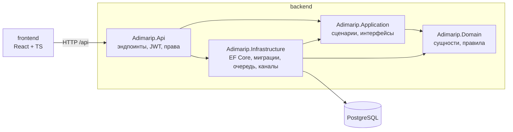
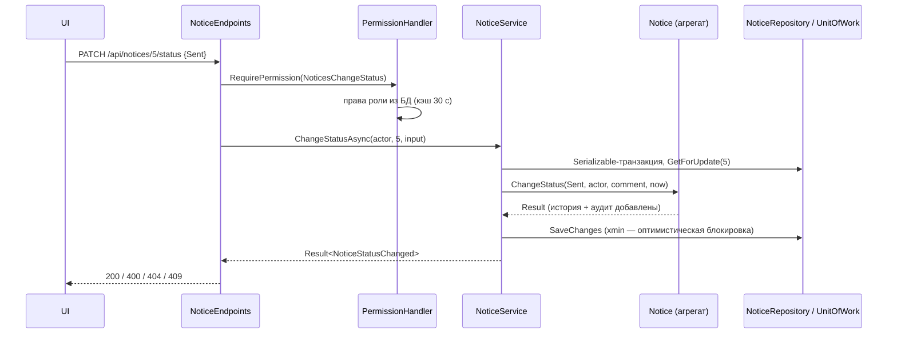
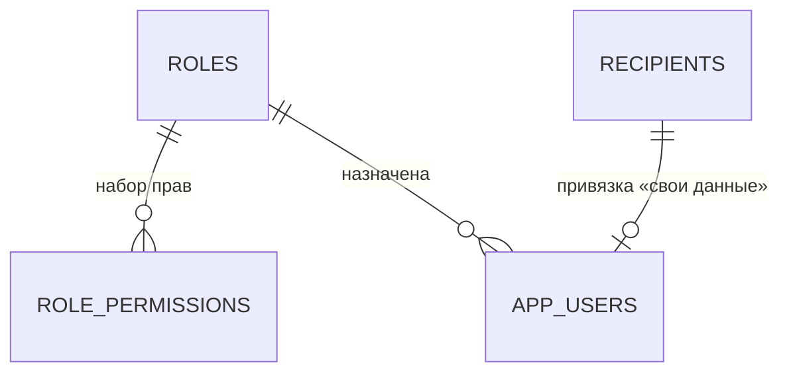
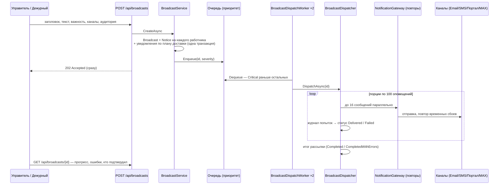

# Архитектура АДИМАРИП (выпуск №70, 20.11.2026)

Документ объясняет, **как устроен код** после доработки «массовое оповещение + кастомные роли»
и **какие паттерны** где применены. Он предназначен для защиты проекта и для новых участников команды.

## 1. Что было не так

| Было (до 19.11.2026) | Почему это «спагетти» | Стало |
|---|---|---|
| Вся логика — в лямбдах `MapPost(...)` по 50–100 строк (`Features/*Routes.cs`) | HTTP, валидация, бизнес-правила и SQL перемешаны; ничего нельзя протестировать без БД | Эндпоинт — 1–2 строки: вызвать сервис и перевести `Result` в HTTP |
| Анемичные сущности с публичными сеттерами | Любой код мог поставить `CurrentStatus = "Closed"` в обход истории и аудита | Богатая модель: статус меняется только через `Notice.ChangeStatus(...)`, история и аудит пишутся внутри агрегата |
| Конечный автомат статусов продублирован в C# и TypeScript | При изменении правил фронтенд «врёт» | Единственный источник — `NoticeLifecycle`; переходы приходят в карточке (`allowedTransitions`) |
| Роли — строки `"Operator"`, `"Observer"`… разбросаны по 15 местам, `if (IsInRole(...))` | Новую роль не добавить без правки кода в десятке файлов | Права (`Permission`) + роли как наборы прав в БД; проверка `RequirePermission(...)` |
| Сырые SQL и ADO.NET (`UserStore`, `RecipientArchives`) рядом с EF | Два способа доступа к данным, ручной маппинг | Все таблицы отображены в EF, доступ через репозитории |
| Магические строки статусов, каналов, действий аудита | Опечатка = ошибка в рантайме | `enum` + конвертация в строку в БД; `AuditActions` |
| Мёртвый код: `App.tsx` чекпоинта 2, дубликат ТЗ, второй `api_acceptance.py` | Путает, что реально используется | Удалено |
| Frontend: JSX-строки по 300 символов, проверки `session.role === 'Operator'` | Нечитаемо, меню не расширяется | Слой `api/` (клиент, типы, эндпоинты), хуки, компоненты по одной задаче, меню из конфигурации по правам |
| Одинаковый `try { Save } catch { 409 }` в каждом сервисе | Дублирование, легко забыть | `IUnitOfWork.SaveAsync(conflictMessage)` и транзакционная версия |
| `Enum.TryParse` + `IsDefined` в пяти местах | Принимал числа: статус `"1"` становился `Sent` | Один строгий `EnumNames.TryParse` (только точное имя) |
| Стиль кода «на глаз» | Каждый пишет по-своему | `.editorconfig`, `dotnet format`, ESLint, Prettier — проверяются в CI |

## 2. Слои (Clean Architecture)



**Правило зависимостей:** стрелки направлены только внутрь. `Domain` не знает ни про EF Core, ни про ASP.NET;
`Application` знает только про `Domain` и описывает порты (`INoticeRepository`, `INotificationGateway`,
`IBroadcastQueue`, `IUnitOfWork`, `IClock`…); `Infrastructure` их реализует; `Api` всё собирает (корень композиции).

| Проект | Что внутри | Зависит от |
|---|---|---|
| `Adimarip.Domain` | Агрегаты `Notice`, `Recipient`, `Broadcast`, `Role`, `AppUser`; `NoticeLifecycle`, `DeliveryPlanner`, `BroadcastAudience`; `Result`/`Error` | — |
| `Adimarip.Application` | Сервисы сценариев — по одному на группу задач: `NoticeService`, `NotificationService`, `AppealService`, `DocumentService`, `DirectoryService`, `BroadcastService`, `BroadcastDispatcher`, `AuthService`, `RoleService`, `UserAdminService`; DTO; порты; `NotificationGateway` с повторами | Domain |
| `Adimarip.Infrastructure` | `AdimaripDbContext` + `IEntityTypeConfiguration` на каждую сущность, миграции, репозитории, `UnitOfWork`, имитаторы каналов, `InMemoryBroadcastQueue`, `BroadcastDispatchWorker`, стартовые задачи | Domain, Application |
| `Adimarip.Api` | Группы эндпоинтов (маршрут и право — одна строка, обработчик — именованный метод), JWT, `PermissionAuthorizationHandler`, `Actor`, `ResultHttpExtensions` | Application, Infrastructure |
| `Adimarip.Tests` | xUnit: домен, сервисы на in-memory фейках, очередь и каналы | все |

### Путь запроса (на примере смены статуса)



## 3. Паттерны проектирования

| Паттерн | Где | Зачем |
|---|---|---|
| **Layered / Clean Architecture** | 4 проекта backend | Бизнес-правила не зависят от БД и веба, их можно тестировать изолированно |
| **Rich Domain Model, Aggregate** | `Domain/Notices/Notice.cs`, `Broadcast.cs`, `Role.cs` | Инварианты (даты, переходы, история, аудит) охраняет сам объект; сеттеры приватные (инкапсуляция) |
| **Factory Method** | `Notice.Register`, `Recipient.Create`, `Role.CreateCustom`, `Broadcast.Create`, `AppUser.Create` | Объект нельзя создать в некорректном состоянии |
| **State (табличный конечный автомат)** | `Domain/Notices/NoticeLifecycle.cs` | Одно место с правилами переходов; используют домен, API и UI |
| **Result / Notification** | `Domain/Common/Result.cs` + `Api/Http/ResultHttpExtensions.cs` | Ожидаемые ошибки — значения, а не исключения; единая схема `{error}` и HTTP-кодов |
| **Guard / строгий разбор ввода** | `Domain/Common/TextRules.cs`, `Domain/Common/EnumNames.cs` | Нормализация строк и разбор перечислений в одном месте |
| **Repository** | `Application/Abstractions/Repositories.cs` → `Infrastructure/Persistence/Repositories/*` | Сервисы не пишут LINQ к EF; запросы собраны в одном месте |
| **Unit of Work** | `IUnitOfWork` → `Persistence/UnitOfWork.cs`; `UnitOfWorkExtensions.SaveAsync` | Одна транзакция на сценарий; ошибки EF/Npgsql → `PersistenceConflictException` → 409 без дублирования `try/catch` |
| **Specification** | `Domain/Broadcasts/BroadcastAudience.cs` → `RecipientRepository.Audience(...)` | «Кого оповещаем» описывается в домене и переводится в SQL в инфраструктуре |
| **Strategy** | `IChannelSender` + `SimulatedEmailSender`/`Sms`/`Portal`/`Max`; адресные стратегии в `DeliveryPlanner` | Новый канал (например, Госуслуги) — новый класс, без правки остального кода |
| **Template Method** | `Infrastructure/Delivery/SimulatedChannelSenders.cs` (`SimulatedChannelSender.SendAsync` → `ValidateAddress`) | Общий сценарий имитации, отличается только проверка адреса |
| **Retry (resilience) / Decorator-подобная политика** | `Application/Delivery/NotificationGateway.cs` | Временные сбои повторяются с экспоненциальной задержкой, постоянные — нет |
| **Fallback** | `DeliveryPlanner.Plan` | Без нужного контакта сообщение уходит на портал — никто не остаётся без оповещения |
| **Producer–Consumer + Priority Queue** | `IBroadcastQueue` → `InMemoryBroadcastQueue`, `BroadcastDispatchWorker` (`Delivery:Consumers`, по умолчанию 2) | HTTP-запрос не ждёт рассылку; срочные рассылки идут вне очереди |
| **Proxy (кэширующий)** | `Infrastructure/Security/CachedRoleSnapshotProvider.cs` | Права проверяются на каждом запросе без лишних обращений к БД; сброс при изменении роли |
| **Adapter / Port** | `AspNetPasswordHasher` (над `PasswordHasher` Identity), `UnitOfWork` (над `DbContext`), `HealthProbe` (`IHealthProbe`) | Application и Api не зависят от сторонних API и EF |
| **Command + Pipeline (стартовые задачи)** | `Infrastructure/Startup/StartupTasks.cs`: `StartupPipeline` (миграции → bootstrap-админ → демо-данные), каждый шаг в своей области DI | Program.cs не содержит логики инициализации; порядок задаётся при регистрации |
| **Optimistic Concurrency** | `Notice.Version` ↔ системный столбец PostgreSQL `xmin` | Параллельные изменения одной записи дают 409, а не «потерянное обновление» |
| **Composition Root / DI** | `Api/Composition/ApplicationServices.cs`, `Infrastructure/DependencyInjection.cs` | Зависимости собираются в одном месте |

Принципы SOLID: **S** — каждый сервис отвечает за один набор сценариев; **O** — новые каналы/права/роли без изменения существующего кода;
**L** — все `IChannelSender` взаимозаменяемы; **I** — узкие репозитории вместо одного «God-DbContext» в сервисах;
**D** — Application зависит от абстракций, реализации подставляет DI.

## 4. Кастомные роли



* **Право** (`Domain/Access/Permission.cs`) — атомарная возможность: `NoticesReadAll`, `NoticesReadOwn`, `BroadcastsSend`, `AuditView`, `RolesManage`… (17 штук, справочник с описаниями — `PermissionCatalog`, `GET /api/permissions`).
* **Роль** — именованный набор прав. Четыре исходные роли стали **системными** (их нельзя изменить или удалить, но можно скопировать) с теми же правами, что были раньше — поведение для существующих пользователей не изменилось.
* **Область данных** выводится из прав: `NoticesReadAll` → весь реестр, `NoticesReadOwn` → только свои оповещения. Для роли «только свои» учётная запись **обязана** быть привязана к адресату — при создании пользователя адресат создаётся в той же транзакции (обобщение прежнего правила «служащий = адресат»).
* **Проверка на сервере** — `RequirePermission(...)` на каждом маршруте и `UserAccess.RecipientFilter()` в сервисах. Права берутся **из БД**, а не из токена, поэтому изменение роли действует сразу, без повторного входа.
* Защита от самоблокировки: инженер не может снять с себя `UsersManage` и убрать `RolesManage` у собственной роли; роль с пользователями нельзя удалить.
* Пример кастомной роли в демо-данных — `DutyOfficer` «Дежурный по безопасности» (видит реестр и запускает массовые оповещения), учётная запись `duty`.

API: `GET/POST /api/roles`, `PUT/DELETE /api/roles/{name}`, `GET /api/permissions`, `GET /api/admin/users`, `PUT /api/admin/users/{username}/role`.

## 5. Массовое оповещение работников

Требование корпорации: «угроз стало слишком много, работники должны оповещаться быстрее».



Что сделано для скорости и надёжности:

1. **Асинхронность.** Запрос только регистрирует рассылку (ответ `202`), доставка идёт в фоне — тысяча работников не упирается в таймаут HTTP.
2. **Параллельная отправка** (`Delivery:MaxParallelism`, по умолчанию 16) и **порции** по 100 оповещений на транзакцию.
3. **Приоритет.** `Critical` извлекается из очереди первым; рассылки обрабатывают два потребителя очереди (`Delivery:Consumers`), поэтому срочная рассылка не ждёт окончания большой плановой.
4. **Максимальный охват для срочных.** Для `Critical` используются **все** каналы, для которых у работника есть контакт.
5. **Резервный канал.** Нет контакта для выбранного канала → личный кабинет на портале.
6. **Повторы.** Временные сбои повторяются (до 3 попыток, экспоненциальная задержка; для срочных — без нарастания), постоянные (неверный адрес) — нет.
7. **Идемпотентность и восстановление.** Очередь в памяти, но источник истины — БД: после перезапуска обработчик продолжит незавершённые рассылки с того места, где остановился; уже доставленные уведомления повторно не отправляются.
8. **Обратная связь.** Работник видит срочное оповещение баннером в «Моих оповещениях» и нажимает «Ознакомлен(а)» (`POST /api/notices/{id}/acknowledge`, право `NoticesAcknowledgeOwn`); в отчёте рассылки видно, сколько человек подтвердили получение. Подтверждение, пришедшее во время рассылки, не затирается (оптимистическая блокировка по `xmin`).
9. **Связь статуса с доставкой** (пункт M11 roadmap): оповещения рассылки переходят `Created → Sent → Delivered/Failed` автоматически по результатам попыток.

Ограничения учебной версии: доставка **имитируется** (реальные SMS/e-mail не отправляются), рассылка доступна только при `DEMO_ENABLED=true` (иначе `501`), не более 2000 адресатов за раз, очередь живёт в одном процессе API.

## 6. Frontend

```
src/
  api/          client.ts (fetch, разбор ошибок, авто-выход при 401), session.ts (can(), seesOnlyOwn()), types.ts, endpoints.ts
  hooks/        useAsync (загрузка, отбрасывает устаревшие ответы), useAction (изменения), queries.ts (useOffices, useRoles…)
  components/   Feedback, Chips, Fields (TextField, SelectField)
  shared/       labels.ts (русские названия статусов/каналов), collections.ts
  app/          RegistryApp, Header, LoginPage, navigation.ts (меню по правам), useSession, useApiHealth
  features/
    notices/    NoticesSection → NoticesPanel (NoticeFilters, NoticesTable, BulkSendBar, UrgentBanner),
                NoticeDetailPanel, NoticeActions, CreateNoticePanel, ChannelAddressFields
    broadcasts/ BroadcastsPanel, BroadcastComposer (+ useBroadcastForm, AudiencePicker, useAudiencePreview),
                BroadcastJournal, BroadcastReport, broadcastStatus (isRunning)
    recipients/ RecipientsPanel
    admin/      UsersPanel (CreateUserForm, UsersTable), RolesPanel (RoleEditor)
```

* Интерфейс проверяет **права**, а не названия ролей, поэтому кастомная роль сразу получает правильное меню.
  Это только удобство: настоящая защита — на сервере.
* Компонент делает одно дело и укладывается в 80 строк; логика форм вынесена в хуки (`useBroadcastForm`).
* Загрузчики данных мемоизируются (`useCallback`) — правило `react-hooks/exhaustive-deps` проверяет зависимости,
  отключений правил в коде нет.

## 7. Тесты

* `backend/Adimarip.Tests` — 95 модульных тестов: конечный автомат, агрегат `Notice`, роли и области данных,
  планировщик доставки, повторы шлюза, сервисы на in-memory фейках (создание рассылки, доставка порциями,
  отчёт, сохранность подтверждения), очередь с приоритетом, имитаторы каналов. `dotnet test backend/Adimarip.sln`.
* `tests/api_acceptance.py` — сквозной сценарий против запущенного стека, дополнен кастомными ролями и массовым оповещением.
* `tests/sql/schema-verification.sql` — инварианты БД, дополнены проверками ролей и рассылок.

## 8. Инструменты чистоты кода

| Инструмент | Что проверяет | Где |
|---|---|---|
| `.editorconfig` | Отступы, длина строки 140, пространства имён, `using`, именование полей и констант | корень репозитория |
| `dotnet format whitespace --verify-no-changes` | Оформление C# соответствует `.editorconfig` | CI |
| `dotnet build -warnaserror` | Сборка без предупреждений (включая nullable) | CI |
| ESLint (`typescript-eslint` strict, `react-hooks`) | Ошибки и запахи кода в TypeScript, зависимости хуков, сложность ≤ 12, функция ≤ 80 строк, без вложенных тернарников | `frontend/eslint.config.js`, CI с `--max-warnings 0` |
| Prettier | Единое оформление TypeScript/CSS/JSON | `frontend/.prettierrc.json`, CI |
| `tsc` strict | Типы во frontend | `npm run build` |

Локально: `dotnet format whitespace backend --folder` и `cd frontend && npm run lint && npm run format`.
