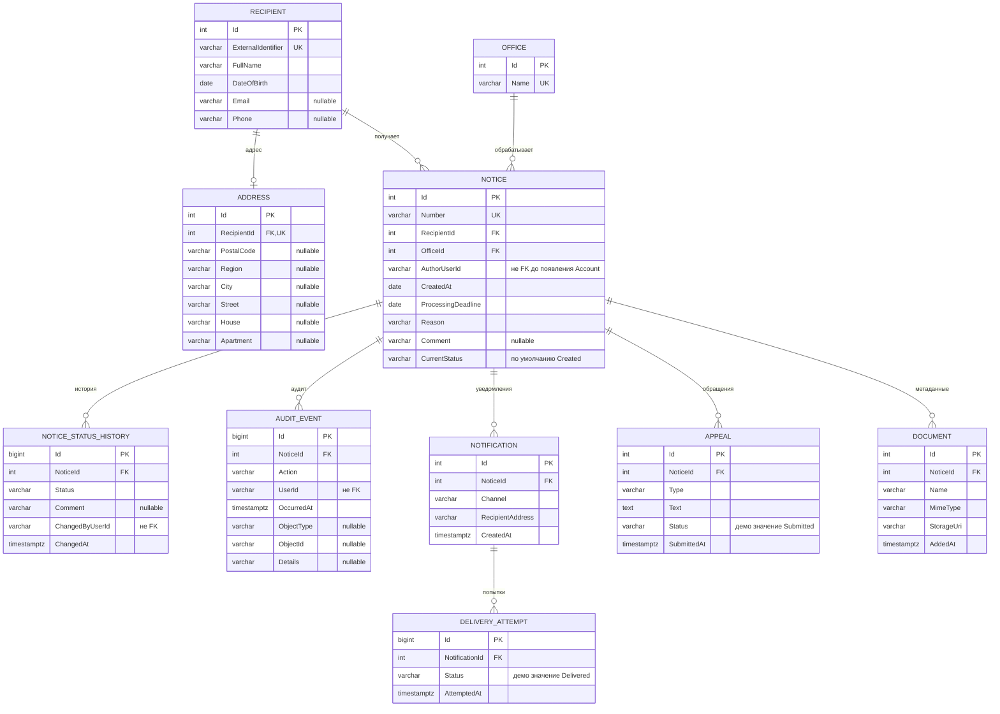

# ERD — реестр оповещений «АДИМАРИП»

**Статус:** проект модели данных для будущей системы. В исходном архиве уже есть `adimarip-efcore/Adimarip.Data/Entities/`, `AdimaripDbContext` и черновая миграция. **Таблицы не разворачиваются автоматически на семинаре 2.**

Диаграмма сопоставлена с текущими C#-сущностями: реальные ключи `int`/`long`, а идентификаторы пользователей пока строковые. `USER`/`ACCOUNT` и ролевое хранилище **ещё не реализованы**, связи с ними в БД отсутствуют. Это важное отличие от первоначального логического ERD с `uuid`.

## Кардинальности и ограничения

| Связь | Кратность существующей модели | Ограничения |
|---|---|---|
| Recipient → Address | 1 : 0..1 на уровне БД | `Address.RecipientId` уникален; бизнес-процесс создания адресата предполагает обязательный адрес в будущем API |
| Recipient → Notice | 1 : 0..N | Нельзя создать Notice без существующего Recipient |
| Office → Notice | 1 : 0..N | Нельзя создать Notice без существующего Office |
| Notice → StatusHistory / AuditEvent | 1 : 0..N | После внедрения CRUD история и аудит должны записываться атомарно с изменением статуса |
| Notice → Notification / Appeal / Document | 1 : 0..N | Содержимое документов не загружается |
| Notification → DeliveryAttempt | 1 : 0..N | Будущая отправка демонстрационная, без внешнего SMS/e-mail провайдера |

Уникальные индексы: `Recipient.ExternalIdentifier`, `Office.Name`, `Notice.Number`, `Address.RecipientId`. В `AdimaripDbContext` заданы ограничения `Notice.ProcessingDeadline >= Notice.CreatedAt` и непустая `Notice.Reason`. Даты хранятся как `DateOnly`, время событий — `DateTimeOffset`.

> Модель ролей и нерешённые вопросы будут дополнены в следующей итерации ERD.
