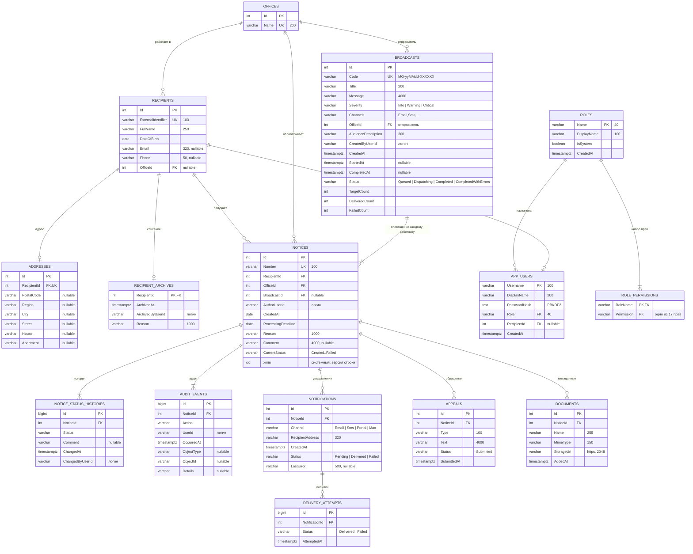

# ERD — реестр оповещений «АДИМАРИП»

**Статус:** действующая схема БД после миграции `202611190006_RolesAndBroadcasts` (20.11.2026).
Таблицы создаются и обновляются автоматически при старте API (`Database.MigrateAsync`, см.
[`DATABASE_MIGRATIONS.md`](DATABASE_MIGRATIONS.md)). Сущности — `backend/Adimarip.Domain`, отображение —
`backend/Adimarip.Infrastructure/Persistence/Configurations`.

Ключи — `int`/`bigint` (identity), у учётных записей и ролей — строковые (`Username`, `Name`). Авторы действий
(`AuthorUserId`, `ChangedByUserId`, `UserId`, `CreatedByUserId`, `ArchivedByUserId`) хранятся логином без внешнего
ключа — чтобы журналы не зависели от удаления учётных записей (открытый вопрос О-4).

## Кардинальности и правила удаления

| Связь | Кратность | Ограничения |
|---|---|---|
| Office → Recipient | 1 : 0..N | `ON DELETE SET NULL` — работник остаётся без подразделения |
| Recipient → Address | 1 : 0..1 | `Address.RecipientId` уникален, каскадное удаление |
| Recipient → RecipientArchive | 1 : 0..1 | Наличие записи = адресат списан; `RESTRICT` |
| Recipient / Office → Notice | 1 : 0..N | `RESTRICT`; нельзя создать оповещение без существующих адресата и подразделения |
| Broadcast → Notice | 1 : 1..N | `RESTRICT`; номер оповещения — `{Code}-{RecipientId}` |
| Notice → StatusHistory, AuditEvent | 1 : 1..N | Пишутся одной транзакцией с изменением оповещения; через API не меняются |
| Notice → Notification, Appeal, Document | 1 : 0..N | Каскадное удаление вместе с оповещением |
| Notification → DeliveryAttempt | 1 : 0..N | Журнал попыток; итог — в `Notifications.Status` |
| Role → RolePermission | 1 : 1..N | Каскадное удаление; CHECK на допустимые коды прав |
| Role → AppUser | 1 : 0..N | `ON UPDATE CASCADE`, `ON DELETE RESTRICT` — роль с пользователями не удалить |
| Recipient → AppUser | 1 : 0..1 | Обязательна для ролей «только свои данные»; для `Observer` — CHECK `CK_AppUsers_Observer_Recipient` |

## Индексы и ограничения

* **Уникальные:** `Recipients.ExternalIdentifier`, `Offices.Name`, `Notices.Number`, `Addresses.RecipientId`,
  `AppUsers.Username` (PK), `Roles.Name` (PK), `Broadcasts.Code`.
* **CHECK:** `Notices.ProcessingDeadline >= CreatedAt`; непустая `Notices.Reason`; допустимые значения
  `Notices.CurrentStatus`, `Notifications.Channel`, `Notifications.Status`, `DeliveryAttempts.Status`,
  `RolePermissions.Permission`, `Broadcasts.Severity`, `Broadcasts.Status`; формат `Roles.Name`; непустой `Broadcasts.Title`.
* **Для запросов:** `Notices (RecipientId)`, `(OfficeId)`, `(RecipientId, CreatedAt)`, `(OfficeId, CurrentStatus)`,
  `(CurrentStatus, CreatedAt)`, `(BroadcastId, CurrentStatus)`; `Notifications (NoticeId)`, `(NoticeId, Status)`, `(CreatedAt)`;
  `DeliveryAttempts (NotificationId, AttemptedAt)`; `NoticeStatusHistories (NoticeId, ChangedAt)`;
  `AuditEvents (NoticeId, OccurredAt)`; `Appeals (NoticeId)`; `Documents (NoticeId)`; `Recipients (OfficeId)`;
  `Broadcasts (Status)`; `AppUsers (Role)`.
* **Параллельные изменения:** обновление `Notices` проверяет системный столбец PostgreSQL `xmin`; при расхождении — 409.

Типы: даты — `date` (`DateOnly`), моменты времени — `timestamptz` (`DateTimeOffset`), перечисления хранятся строками.
